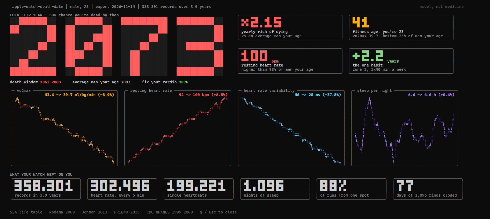

# apple-watch-death-date

Your Apple Watch has been grading your heart every day. This reads the whole Health export, shows what it kept on you, and turns your vo2max and resting heart rate into a death date. Everything runs in your terminal, Python 3 standard library only, nothing gets uploaded.

## What it found on my watch

- 358,301 records in 3 years. My heart rate every 5 minutes, day and night
- 199,221 of my single heartbeats, each timestamped to 1/100 of a second
- 88% of my runs start within 150 m of one spot. My front door
- my HRV crashes after every Sunday night: 27 ms vs 38 ms the rest of the week
- vo2max down 8.9% in 3 years: bottom 23% of men my age, fitness age 41. I'm 23
- resting heart rate 100: higher than 98% of men my age
- my yearly risk of dying: x2.15 an average guy my age
- coin-flip year 2073. An average 23-year-old man gets 2083
- zone 2, 3x40 min a week (vo2max +10%) buys back 2.2 years

## Use it

**1. Export your data.** Health app on your iPhone, tap your profile picture in the top right, tap Export All Health Data, get the zip onto your computer.

**2a. In Claude Code.** Install the skill once:

    git clone https://github.com/phosphenq/apple-watch-death-date ~/.claude/skills/death-date

Then open Claude Code next to the zip and type `/death-date`, or just ask "when do I die?".

**2b. Without installing anything.** Paste the prompt from [prompts/when-do-i-die.md](prompts/when-do-i-die.md) into Claude Code with your zip.

**2c. Just the scripts:**

    python3 scripts/watch_feed.py export.zip --death --big --dashboard   # everything, ends in a full-screen dashboard
    python3 scripts/death_date.py export.zip --big       # just the model, the year in giant digits
    python3 scripts/dashboard.py export.zip              # the dashboard in this terminal
    python3 scripts/live.py beats export.zip             # every single heartbeat it kept, streamed
    python3 scripts/live.py gps export.zip               # every route you ran, drawn on top of each other

The zip works as is, so does the unzipped `apple_health_export` folder or `export.xml`. No export at hand? Use `sample/watch-export.zip`, a made-up 23-year-old (rebuild it with `python3 sample/gen_sample.py`). Add `--mask` before you screenshot anything: it hides your name, birth date and GPS.

## How the death date is computed

It's a model, not medicine. Every step is in `scripts/death_date.py`:

1. **Baseline.** Your yearly probability of dying at each age, from the US Social Security period life table for your sex ([ssa.gov](https://www.ssa.gov/oact/STATS/table4c6.html), `data/ssa_period_life_table.csv`), starting from your exact age (the birth date is inside the export).
2. **Cardio fitness.** Your recent vo2max against the median for your age and sex from the FRIEND registry (Kaminsky et al., Mayo Clin Proc 2015). Every MET (3.5 ml/kg/min) of difference multiplies the yearly risk by 0.87 (Kodama et al., JAMA 2009, meta-analysis of 33 studies).
3. **Resting heart rate.** Your recent resting HR against the US mean for your age and sex (CDC NHANES 1999-2008, Ostchega et al. 2011). Every 10 bpm multiplies the risk by 1.16, an estimate already adjusted for fitness (Jensen et al., Heart 2013).
4. **Survival curve.** Proportional hazards, year by year to age 119. Coin-flip year: the year it crosses 50%. Death window: 25% to 75% of outcomes.
5. **The one habit.** The same model with vo2max +10%.

## What's inside

- `SKILL.md`: the Claude Code skill (`/death-date`)
- `prompts/when-do-i-die.md`: the same job as one copy-paste prompt
- `scripts/watch_feed.py`: streams export.xml straight from the zip, prints the record map, the privacy findings and month-by-month trends; `--json` saves everything
- `scripts/death_date.py`: the model above; `--big` prints the year in giant digits
- `scripts/dashboard.py`: full-screen terminal dashboard (giant LED year, braille curves), `--new-window` opens it in a new terminal
- `scripts/live.py`: live views of your own records in the terminal: `beats`, `hr`, `sleep`, `gps`, `survival`
- `scripts/mask.py`: masks names, birth dates, GPS, serials, emails in any output
- `data/`: the SSA life table, FRIEND vo2max percentiles, NHANES resting pulse percentiles
- `sample/`: the made-up export and its generator

## License

MIT. The data tables come from US government sources (SSA, CDC) and the papers cited above.
